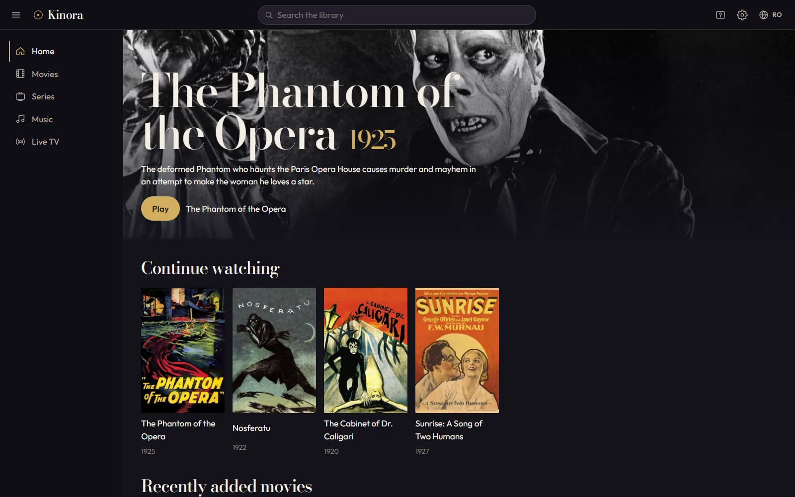
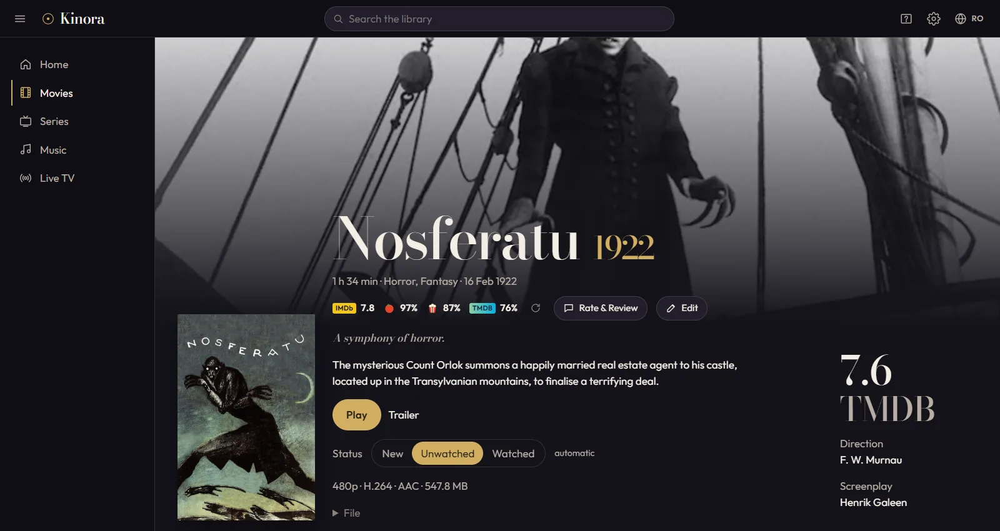
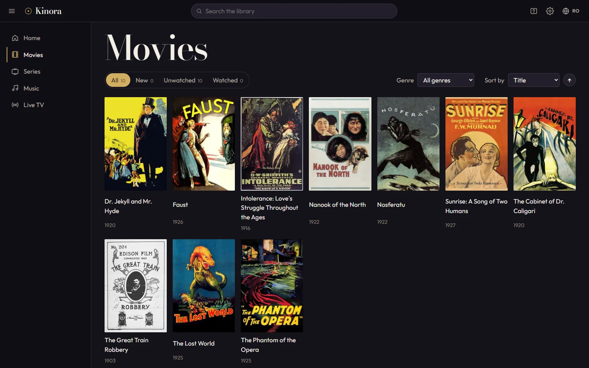
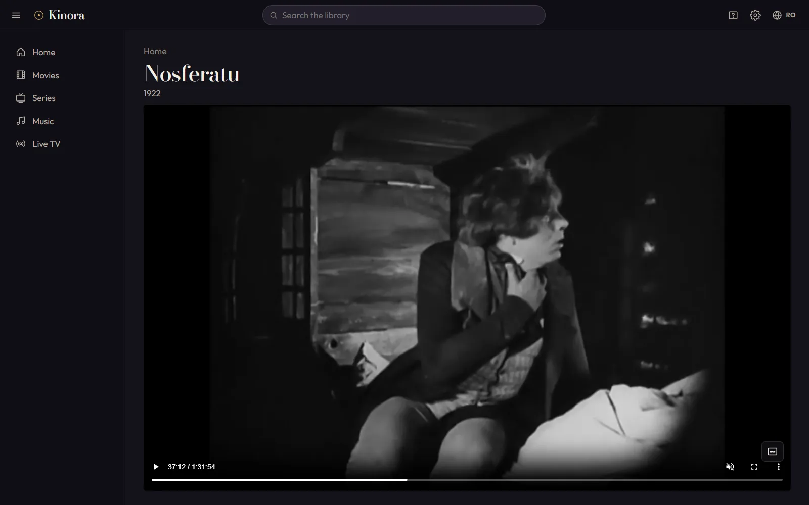
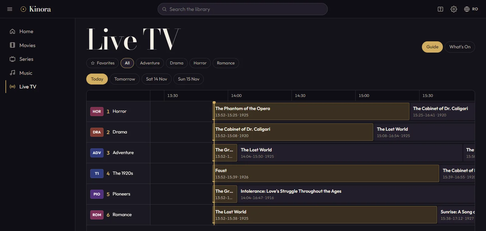
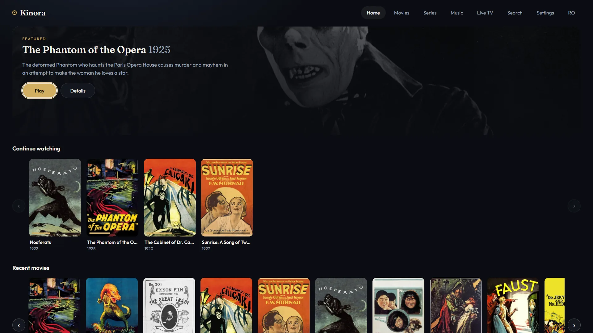
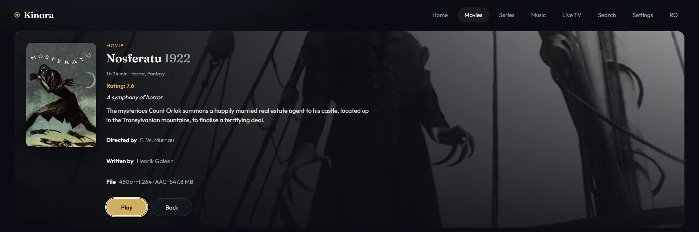
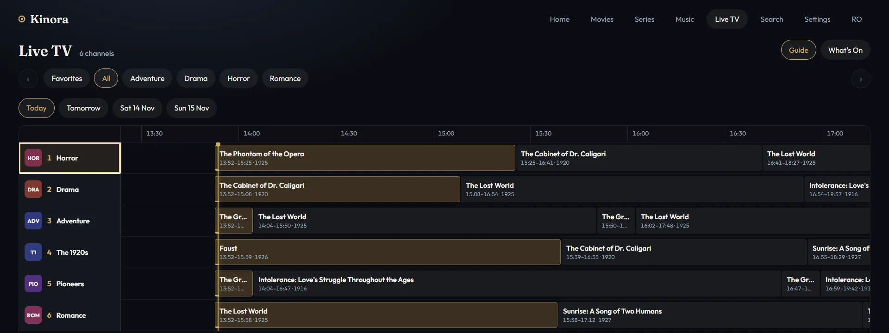

# Kinora

Kinora is a personal media server for movies, series and music. It scans folders on local disks or network shares, fetches posters, cast and trailers from TMDB (album covers from MusicBrainz) and plays everything in the browser. Whatever cannot be played directly is converted on the fly with ffmpeg into an HLS stream.

The interface is available in English and Romanian.



## Screenshots

| | |
|---|---|
|  |  |
| **Movie details**: ratings, artwork and file info | **Library**: filters by status and genre |
|  |  |
| **Player**: direct play, remux or on-the-fly transcoding | **Live TV**: virtual channels built from the library |

### TV interface

| | |
|---|---|
|  |  |
| **Home** on a TV, driven by the remote's D-pad | **Movie details** at 10-foot scale |



<sub>The screenshots show public-domain silent films (1903–1927). Nosferatu plays from the CC0 copy on the [Internet Archive](https://archive.org/details/Nosferatu1922). Metadata, period posters and film stills come from [TMDB](https://www.themoviedb.org/); Kinora is not endorsed or certified by TMDB.</sub>

## Requirements

| Component | Why |
|---|---|
| **Node.js 22+** (tested with 24) | the server runs TypeScript directly through `tsx` |
| **pnpm 10** via Corepack | the project is a pnpm monorepo (`corepack enable`) |
| **ffmpeg and ffprobe** | technical details, embedded subtitles, remux and transcoding |
| **TMDB token** (optional) | metadata for movies and series |

On Windows, the easiest way to install ffmpeg is:

```powershell
winget install Gyan.FFmpeg
```

Kinora finds it in `PATH` or in the winget packages folder, so you do not need to restart the terminal after installing. Without ffprobe, technical details are missing. Without ffmpeg, only files the browser can play directly will play.

The TMDB token is the "API Read Access Token" from your [TMDB account settings](https://www.themoviedb.org/settings/api). Enter it on the **Settings** page in the app.

Titles, overviews and genres are fetched in English by default. **Settings → Metadata → Metadata language** switches them to Romanian; titles already matched are refreshed in the background. Installs that matched titles before this setting existed keep Romanian.

## Getting started

```bash
corepack enable
pnpm install
pnpm dev
```

- Development UI: <http://localhost:5173>. Vite forwards `/api` requests to the server.
- Server: <http://127.0.0.1:3001>.

On first start, open **Settings**, add a folder (movies, series or music, one path per line) and, optionally, the TMDB token. Scanning starts right away. Folders are watched, so new files show up on their own.

### Everyday use (without Vite)

```bash
pnpm build   # builds the UI into apps/web/dist
pnpm start   # the server serves the UI and the API on port 3001
```

## Configuration

Most settings are made on the **Settings** page and stored in the database. A few are environment variables:

| Variable | Default | Purpose |
|---|---|---|
| `PORT` | `3001` | server port |
| `KINORA_ALLOWED_ORIGINS` | – | extra origins accepted by the API, comma-separated (e.g. a reverse proxy: `https://media.home`) |
| `KINORA_VIDEO_ENCODER` | `libx264` | H.264 encoder used for transcoding, e.g. `h264_nvenc` (NVIDIA), `h264_qsv` (Intel), `h264_amf` (AMD) |
| `KINORA_IPTV_MAX_STREAMS` | `4` | maximum number of IPTV relays running at once |

### Network access

By default, Kinora listens only on `127.0.0.1`. To reach it from other devices:

1. In **Settings**, choose an access key.
2. Change the address to `0.0.0.0` or to the computer's IP.
3. Restart the server.

The server refuses to start on an external address without an access key. The key is sent as an `Authorization: Bearer …` header or through the cookie set at sign-in.

Built-in protections:
- The API accepts browser requests only from the page served by Kinora, from the Vite dev server or from `KINORA_ALLOWED_ORIGINS`. Other sites get `403`.
- While the server listens only locally, a non-local `Host` gets `421`, as protection against DNS rebinding.
- Files are served only from inside the library folders.

## How a file is played

| File | Mode | What the server does |
|---|---|---|
| MP4/MOV/M4V with H.264 and AAC/MP3, WebM with H.264/VP9 and Opus/Vorbis | `direct` | sends the file with HTTP Range support |
| H.264 with AAC/MP3 in another container (MKV, AVI, TS) | `remux` | copies the tracks into HLS segments (fast) |
| H.264 with other audio (AC-3, E-AC-3, DTS…) | `transcode` | copies the video, converts the audio to stereo AAC |
| Any other video codec (HEVC, AV1, VP9 in MKV, MPEG-4…) | `transcode` | converts the video to 8-bit H.264 (up to 1080p) |

Known limitations:
- Conversion starts at the beginning of the file. When the video has to be converted, resuming from a later position or seeking ahead waits until the encoder gets there.
- HDR content is converted without tone mapping, so colors may look washed out.
- Only one conversion runs at a time: opening another file stops the current one.

### Conversion cache

Every conversion is kept in `data/cache/transcode`, so a second viewing starts instantly. The cache has a limit (30 GB by default, configurable in **Settings**):
- conversions unused for 30 days are deleted automatically;
- above the limit, the least recently watched ones are deleted first;
- the conversion in progress is never deleted;
- the **Clear conversions** button deletes everything except the conversion in progress.

### Subtitles

- External subtitles (`.srt`, `.vtt`, `.ass`, `.ssa`) next to the video file are found automatically, as are those embedded in the file.
- All of them are converted to WebVTT. Windows-1250 files are decoded, and Romanian diacritics are fixed (ş→ș, ţ→ț).
- Embedded subtitles reach the player in 60-second chunks around the current position:
  - during remux or transcode, the same ffmpeg command that produces the stream writes them too, with no extra read of the file;
  - during direct play (or for parts converted earlier), the server jumps to that position and reads only that window, one at a time; windows skipped by seeking are cancelled.
  - Chunks that have been read stay in `data/cache/subtitles/chunks`.
- Image-based subtitles (PGS, VobSub) cannot be shown.

## TV interface

Kinora includes a UI built for TVs (D-pad / 10-foot) in `apps/tv`. The architecture and the plan for the Samsung Tizen, LG webOS and Android TV apps are in [docs/smart-tv.md](docs/smart-tv.md).

### In a browser (development)

```bash
pnpm dev
```

- TV UI: <http://localhost:5174/tv/>
- Desktop UI: <http://localhost:5173>
- API: <http://127.0.0.1:3001>

On a TV, or with a keyboard as the remote: arrows to move, Enter to select, Backspace/Escape to go back. In the player: Enter/Space to pause, ←/→ to seek ±10 s.

### On the local network (production)

1. In **Settings** (web UI), set an access key and bind the server to `0.0.0.0` (or the PC's IP), then restart.
2. Build both UIs and start the server:

```bash
pnpm build
pnpm start
```

3. On the TV or a phone, open `http://<pc-ip>:3001/tv/`.

Sharing the API's origin lets files play directly (session cookie). The Tizen/webOS wrappers in `apps/tv/tizen` and `apps/tv/webos` are thin shells that ask for the server address and open `/tv/`.

#### Sideloading on Samsung Tizen

1. Enable Developer Mode on the TV and note its IP.
2. In Tizen Studio, import `apps/tv/tizen` and connect the TV.
3. Run / install the package on the device.
4. On first launch, enter `http://<pc-ip>:3001`.

#### Sideloading on LG webOS

1. Enable Developer Mode and install the [webOS CLI](https://webostv.developer.lge.com/).
2. Package the `apps/tv/webos` folder (`ares-package apps/tv/webos`).
3. Install the IPK on the TV (`ares-install`).
4. On first launch, enter the Kinora address.

### Quick checklist (keyboard as remote)

- [ ] Open `/tv/` and sign in if a key is required
- [ ] Move from Home to Movies / Series with the arrows
- [ ] Open a title and press Play
- [ ] Pause with Enter, seek with the arrows, leave with Escape
- [ ] Progress shows under "Continue watching" when you return

## Project structure

```
apps/server       Fastify API, scanning, metadata, streaming (TypeScript, tsx)
  drizzle/        database migrations (generated)
  src/db/         Drizzle schema and migration runner
  src/livetv/     Live TV: channels, schedule, IPTV, relay
  src/playback/   playback plan, HLS, subtitles, cache
apps/web          React UI (Vite)
apps/tv           TV UI (Vite) + Tizen/webOS shells
packages/shared   API types shared by server and clients
packages/client   client code shared by the web and TV UIs (API, player, i18n, Live TV helpers)
packages/media-ui shared React media components (music visualizer, music video loop)
docs/             design notes and implementation plans
data/             SQLite database and caches (not in git)
```

## Database

Data lives in `data/kinora.db` (SQLite, WAL mode). The schema is defined in [apps/server/src/db/schema.ts](apps/server/src/db/schema.ts), and migrations are applied automatically at startup. Databases created before migrations existed are adopted at the baseline version.

To change the schema:

```bash
# 1. edit apps/server/src/db/schema.ts
pnpm --filter @kinora/server db:generate --name short_description
# 2. review the generated SQL in apps/server/drizzle/ and commit it together with the change
```

Foreign keys are enforced. Deleting a library cascades to its titles, files, subtitles and watch progress. Migrations run with foreign key checks off and end with `PRAGMA foreign_key_check`.

## Tests

```bash
pnpm test        # server tests (node:test)
pnpm typecheck   # server and UIs
```

Tests that start ffmpeg are skipped automatically when ffmpeg is missing. A new test file must be added to the `test` script in [apps/server/package.json](apps/server/package.json).

## Documentation

- [docs/smart-tv.md](docs/smart-tv.md): Smart TV apps (Tizen, webOS, Android TV), architecture and phased plan
- [docs/live-tv-plan.md](docs/live-tv-plan.md): Live TV (virtual channels, IPTV, EPG), plan and implementation notes
